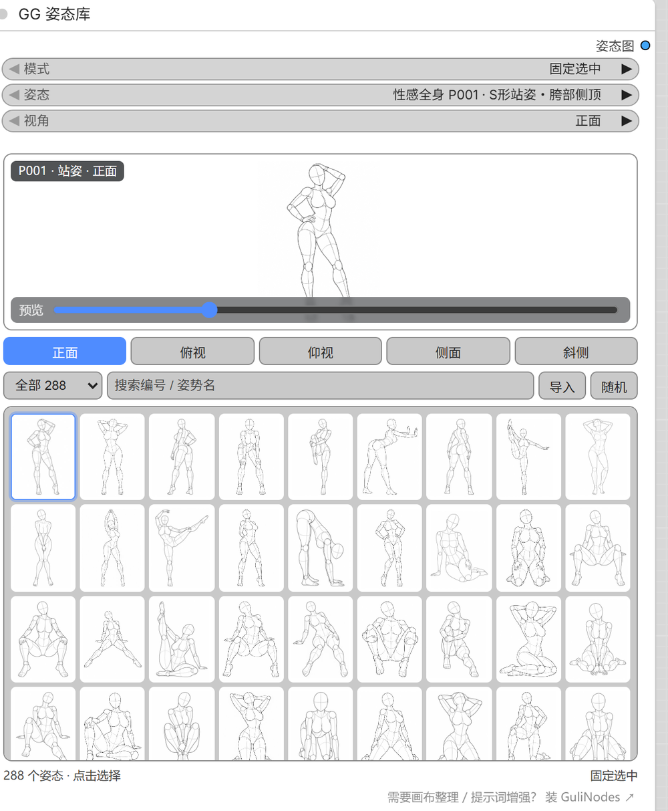
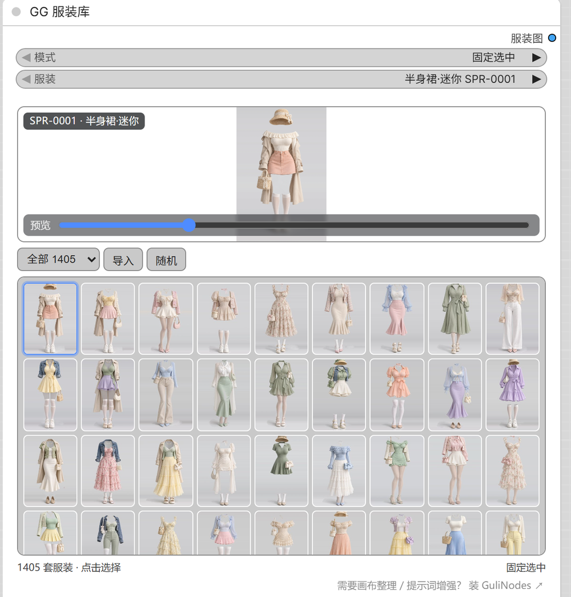
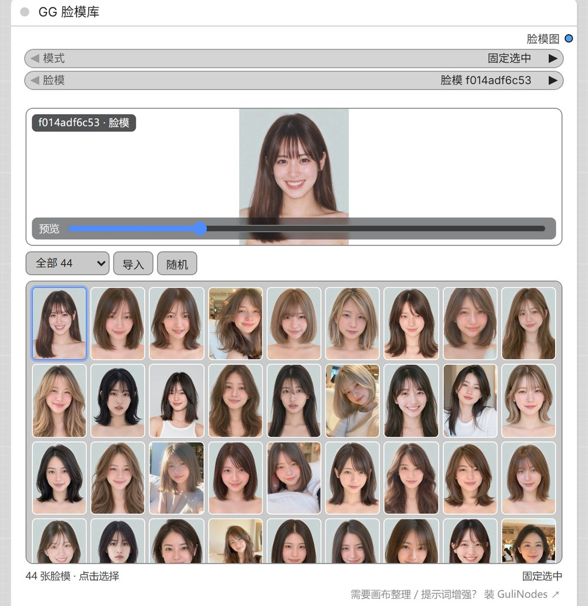

# ComfyUI-GuliPoses

<p align="center">
  <a href="docs/showcase.html"></a>
  <a href="docs/showcase.html"></a>
  <a href="docs/showcase.html"></a>
</p>

<p align="center"><sub>GG 姿态库 288 组 × 5 视角 ｜ GG 服装库 1405 套 ｜ GG 脸模库 44 张 —— <a href="docs/showcase.html">点图看全屏预览 ↗</a></sub></p>

[](https://github.com/comfyanonymous/ComfyUI)
[](https://www.python.org/)
[](#许可与免责)
[](#数据)
[](#数据)
[](#数据)

**在 ComfyUI 节点里翻参考图库，选好就出图。**

白模（3D mannequin 线稿）姿态参考图库节点 **GG 姿态库** 内置 288 组人体姿势 × 5 个视角；另有服装穿搭参考图库节点 **GG 服装库** 内置 1405 套穿搭（单角度）、脸型参考图库节点 **GG 脸模库** 内置 44 张脸模（单角度，可自行补充）。三者都在节点画廊里翻选即出图，输出直接接 ControlNet / Depth / Lineart / IP-Adapter。

> **自己导入的图存在 `ComfyUI/user/default/guliposes/`，不在插件目录里，升级节点不会丢。**
> 从 **v1.2.2 之前**的版本升级上来时，别直接删文件夹覆盖。要么 `git pull` / 覆盖式安装（会自动迁移），要么跑一次 `python tools/upgrade.py full --from <新版.zip> --purge`——它先把插件里的老素材搬到 `user/default/guliposes/` 并打快照，再全量替换，校验不过就拒绝删原件。详见 [升级节点不会丢自己的图](#升级节点不会丢自己的图)。

[English](README_EN.md) · 中文

---

## 特性

| 能力 | 说明 |
| --- | --- |
| 不出画布 | 缩略图栅格就在节点里，点一下即选中，列数随节点宽度伸缩 |
| 三种取图方式 | 固定选中精确复现，全库随机抽卡，范围内随机只在小范围里抽 |
| 随机看得见结果 | 执行后自动跳到真正抽中的姿态；满意的点一下缩略图就锁定，不需要记种子 |
| 可导入自己的图 | 点「导入」、拖进面板或 `Ctrl+V`，自定义名称 / 分类 / 视角 |
| 全中文 · 零依赖 | 参数、输出、分类、姿势名全中文；只用 ComfyUI 自带的 PIL / numpy / torch |

---

## 安装

```bash
cd ComfyUI/custom_nodes
git clone --depth 1 https://github.com/guliacer/ComfyUI-GuliPoses.git
```

没有 git 就下载 [Release 离线包](https://github.com/guliacer/ComfyUI-GuliPoses/releases/latest)（`ComfyUI-GuliPoses-v1.2.3.zip`，约 263 MB），解压后把 `ComfyUI-GuliPoses` 目录放进 `ComfyUI/custom_nodes/`。

已经有旧版、且插件目录里放了自己的图：**别直接删目录覆盖**，用离线包升级时这样跑，会先把素材搬到用户目录再替换：

```bash
python tools/upgrade.py full --from ComfyUI-GuliPoses-v1.2.3.zip --purge
```

重启 ComfyUI，画布空白处右键 → 新建节点 → **GuliPoses** → **GG 姿态库**。

> 仓库自带全部图片（姿态 / 服装 / 脸模共约 270 MB），clone 完就能用，不用另外准备数据。之后 `git pull` 只拉代码改动。

---

## 节点

三个节点结构完全一致，只是底层图库不同。参数名直接就是中文，输出都是一张 `IMAGE`，接 ControlNet / Depth / Lineart / IP-Adapter；分类都是 `GuliPoses`。

| 节点 | 节点 ID | 图库内容 | 视角 | 输出 |
| --- | --- | --- | --- | --- |
| GG 姿态库 | `GuliPosePicker` | 288 组姿态 × 5 视角（1439 张，4 系列 / 26 分类） | 正面 / 俯视 / 仰视 / 侧面 / 斜侧 / 随机 | 姿态图 `900×1200` |
| GG 服装库 | `GuliGarmentPicker` | 1405 套穿搭（6 类型 / 20 分类，单角度） | 正面（控件自动隐藏） | 服装图 `1366×2048` |
| GG 脸模库 | `GuliFacePicker` | 44 张脸模（单角度，可自行扩充） | 正面（控件自动隐藏） | 脸模图 RGB |

### 通用参数

| 参数 | 生效模式 | 说明 |
| --- | --- | --- |
| 模式 | 全部 | 固定选中 / 全库随机 / 范围内随机 |
| 姿态 / 服装 / 脸模 | 固定选中 | 当前库的条目 |
| 视角 | 全部 | 姿态库 6 项；单角度库只有「正面」，控件自动隐藏 |
| 筛选系列 | 范围内随机 | 全部 + 当前库的系列 |
| 筛选分类 | 范围内随机 | 全部 + 当前库的分类 |

- 没有 `seed`，节点不参与采样。
- 参数跟着模式走，只画当前模式下生效的参数，`widgets_values` 顺序不变。
- 节点高度由你定：拉高画廊就变高、多显示几行，切模式不会吸回去。
- 只输出一张图，编号 / 名称写在画廊徽标上。

### 各库差异

- **服装库**：1405 套 × 单角度；按**穿搭类型**分六个系列（半身裙 440 / 连衣裙 391 / 裤装 293 / 内衣·家居 200 / 上装 58 / 泳装 23），二级 20 个分类；原季节留在 `season` 字段，搜索框可搜「春」「派对」，也能搜英文关键词（`pleated`、`denim`）。
- **脸模库**：默认 44 张。脸模源图较多且重复，**只挑选了一部分**做适配；想要更多，把图片（PNG 即可）丢进 `faces/png/`，加载时自动转 WebP 并重建索引，也可跑 `python tools/build_face_db.py`。

---

## 取图模式

| 模式 | 从哪抽 | 用在哪 |
| --- | --- | --- |
| 固定选中 | 「姿态」+「视角」精确取图 | 已经想好要什么姿势，或要复现某次结果 |
| 全库随机 | 全部 288 个姿态 | 批量探索、给一批图随机换姿势 |
| 范围内随机 | 「筛选系列」×「筛选分类」的交集 | 做某个题材的系列图，要有变化又不能跑出范围 |

全库随机时两个筛选参数被忽略，画廊里的系列下拉会变灰。

范围内随机的两个筛选都支持「全部」。选到空组合不会报错，但会**静默放宽范围**（先退到只按系列，再退到全库）——画廊底部的「候选 N 个」显示的是后端真正会用的池子大小，跟着它走就不会意外。

**视角**有六项，选「随机视角」时在该姿态**实际拥有**的视角里抽。

**没有种子怎么固定结果**：随机模式每次都是真随机。想留住某次结果，直接在画廊里点那张缩略图——模式切回固定选中，姿态与视角一起写进工作流。随机模式每次排队都重新抽（节点声明了 `IS_CHANGED`，不会被缓存挡住），固定选中正常走缓存。

---

## 画廊

节点下半部分是一个自绘的 DOM 画廊，从上到下六层：

| 层 | 内容 | 操作 |
| --- | --- | --- |
| 大图预览 | 当前选择，左下角徽标 `编号 · 分类 · 视角` | — |
| 视角栏 | 正面 / 俯视 / 仰视 / 侧面 / 斜侧 | 点一下，整栅格缩略图跟着换成该视角 |
| 工具行 | 系列下拉 · 搜索框 · 「导入」 · 「随机」按钮 | 筛选 / 检索 / 导入自己的图 / 在当前可见范围里挑一个 |
| 缩略图栅格 | 列数随节点宽度自适应；末行只剩一张时自动均分重排 | 点一下即选中 |
| 页脚 | 左边候选数，右边当前模式提示 | — |
| 推荐行 | 一行小字指向配套插件 | 点击打开 ComfyUI-GuliNodes 仓库 |

- 「随机」按钮在**当前可见范围**里挑一个并切回固定选中，不是「记住一个种子」，而是直接把那张图钉进工作流
- 随机模式下预览图若不在当前候选范围里（比如刚改了筛选），图片会压暗、徽标前缀变成「上次 · 」——那是上次执行的结果，不是出错
- 姿态编号跨系列重复（`P001` 有四个系列各一份），所以「姿态」下拉的选项带系列前缀

---

## 数据

**288 组姿态 × 5 个视角 = 1439 张图**（`full_sexy_P018` 缺「仰视」，选到该角度时自动回退到正面）。

| 系列 | 姿态数 |
| --- | --- |
| 全身单人-性感系 | 80 |
| 上半身单人 | 80 |
| 全身单人-标准系 | 73 |
| 双人互动 | 55 |

26 个动作分类（站姿 / 趴卧 / 坐姿 / 跪立・四肢着地 / 贴脸系 …），分类名与姿势名已全部译成中文，日文原文保留在 `catJp` / `nameJp` 字段备查。

### 服装库（GG 服装库）

**1405 套穿搭 × 单角度（正面）= 1405 张图**，按「穿的是什么」分六个类型。原库按季节分目录，找一条百褶裙得在春夏秋冬四个 tab 里各翻一遍，所以重新按品类归了类：一级决定系列 tab，二级是同一主件下的细分（长度 / 版型 / 材质）。

| 系列 | 套数 | 二级分类（套数） |
| --- | --- | --- |
| 半身裙 | 440 | 迷你 207 / 百褶 114 / 常规 82 / 中长 37 |
| 连衣裙 | 391 | 迷你 247 / 常规 94 / 中长 40 / 长款 10 |
| 裤装 | 293 | 长裤 182 / 牛仔 68 / 短裤 38 / 阔腿 3 / 连体 2 |
| 内衣·家居 | 200 | 套装 173 / 家居服 27 |
| 上装 | 58 | 针织 40 / 衬衫 13 / 外套 3 / 吊带 2 |
| 泳装 | 23 | 泳装 |

归类只看英文关键词里的「主件」：有 dress 就是连衣裙，有 skirt 就是半身裙，剩下才看裤子；外套、开衫、包和鞋是叠加层，不参与一级判定（否则「针织开衫 + 迷你裙」会被判成上装）。两条例外靠编号前缀：`LNG-` 是居家内衣套装（里面的 shorts 是睡裤），`SWM-` 里只有一部分真带 swimsuit 关键词，其余是普通夏装。

有 14 套的源关键词把主件词整个漏了，只写了材质和配饰（`satin gloves heels`、`grey pleated loafers bag`），任何规则都判不出来。这批逐张看图确认后钉在 `tools/garment_classify.py` 的 `OVERRIDES` 里：6 套缎面及地礼服归「连衣裙·长款」，8 套阔腿 / 直筒 / 连体裤归裤装。没有放宽关键词规则去拟合它们——`pleated` 在多数场合指裤褶而不是百褶裙，放宽会把普通长裤吸进半身裙。

原始季节仍记在 `season` 字段（春 213 / 夏 254 / 秋 244 / 冬 253 / 内衣 199 / 派对 48 / 泳装 54 / 性感 140），画廊搜索框输入「春」「派对」照样能筛出来；英文关键词也在搜索范围内，搜 `pleated` 能找到百褶裙。

### 脸模库（GG 脸模库）

**44 张 × 单角度（正面）= 44 张图**，分类统一「脸模」。源图是 PNG，转换后统一为 WebP。脸模源图较多且重复，**这里只挑选了一部分做节点适配**——想要更多，自行下载图片丢进用户数据区的 `face/png/` 即可，加载时会自动转 WebP 并重建索引，也可以手动跑 `python tools/build_face_db.py`。

脸模库与服装库同为「平行库」：索引 schema、画廊、导入/删除逻辑全部复用，只是底层目录、角度集（单角度）和源图不同。加新库只需在 `pose_db.LIB_DIRS` 加一项 + 写对应的 `build_*_db.py` + 加一个 `GuliXxxPicker` 节点。

### 目录：哪些随仓库走，哪些是你的

**内置素材在插件目录里，用户自己的素材在插件外面**。这条界线是刻意划的——插件升级（`git pull`、删掉文件夹重新解压、管理器整目录覆盖）只会动插件目录，用户目录碰不到。

```
<插件目录> ComfyUI/custom_nodes/ComfyUI-GuliPoses/
data/zh-dict.csv  # 日→中对照表（323 条）
inbox/            # ★ 收件箱：图包丢这里，启动时自动入库（见下方「整包导入」）
├── pose/ · garment/ · face/
poses/            # 姿态库 · 内置素材
├── img/            # 全尺寸 900×1200 WebP（104 MB，1439 张）
├── thumbs/         # 缩略图——不入库，首次浏览时自动生成
└── index.json      # 姿态库索引
garment/          # 服装库（与 poses/ 平级）
├── img/ · thumbs/ · index.json
faces/            # 脸模库（与 poses/ 平级）
├── img/ · thumbs/ · index.json
└── png/            # 已废弃，只剩一张引导说明，往这里丢图不再被读取

<ComfyUI>/user/default/guliposes/    # ★ 用户素材，升级不会动
├── 说明_README.txt
├── inbox/           # 收件箱的另一份（升级也碰不到，最保险）
├── pose/custom/     # 节点里「导入」的图 + meta.json + thumbs/
├── pose/png/        # 转换来源：原始图（PNG/JPG/BMP）丢这里
├── garment/…
└── face/…
```

内置图就在仓库里，clone 完就能用。原图用 WebP（q95）而不是 PNG：同样 1439 张，PNG 要 343 MB，WebP 只有 104 MB，实测 PSNR 50.9 dB、放大 2.3 倍看不出差别。

`<user>/…/<lib>/png/` 只是转换来源：加载时（或跑 `build_face_db.py`）把里面的原图转成插件内 `img/*.webp`，索引只认 `img/` 里的 WebP。所以**转换产物被升级覆盖也没关系**——源图在你的目录里，下次启动自动重转一遍。

缩略图不占仓库体积——`thumbs/` 为空时，节点在首次请求时用原图现生成并落盘，之后走浏览器缓存。单张 57 ms，画廊懒加载只取可视区，首屏无感。

只有你自己替换或新增了内置图、想重建索引时，才需要这些命令：

```bash
# 重建姿态库索引（读 data/poses.csv，按 data/zh-dict.csv 译成中文）
python tools/build_pose_db.py "D:\path\to\pose-db-01"

# 重建服装库索引（读源库原始数据.json / 关键词表.csv，复制 WebP 到 garment/img）
python tools/build_garment_db.py "C:\Users\Admin\Desktop\PS高速缓存\1407套服装穿搭\服装1407"

# 重建脸模库：把用户数据区 face/png/ 下的原图转成 WebP 并生成 faces/index.json
python tools/build_face_db.py            # 保留原始 PNG
python tools/build_face_db.py --clean    # 转换后删掉原始 PNG，给仓库瘦身
```

脚本读源数据重建各自 `index.json` 并复制原图；索引按修改时间自动重读，不用重启 ComfyUI。

---

## 升级节点不会丢自己的图

以前用户图放在插件的 `poses/custom/`、`garment/custom/`、`faces/custom/`、`faces/png/` 里。这三种升级方式都会连带盖掉它们：

| 升级方式 | 后果 |
| --- | --- |
| `git pull` | git 不认识未跟踪文件，一般不删；但 `git clean -fd` / `git stash -u` 会一起清掉 |
| 删掉文件夹重新解压 | 整个目录被替换，图全没 |
| ComfyUI-Manager 更新 / 重装 | 同「删掉文件夹重新解压」，常见 |

所以 v1.2.2 起用户素材全部搬到 **`ComfyUI/user/default/guliposes/`**，和插件源码彻底分开：

| 你自己的东西 | 现在的位置 |
| --- | --- |
| 节点里「导入」的图 + 显示名/分类（`meta.json`） | `user/default/guliposes/<lib>/custom/` |
| 批量添加的原始图（PNG / JPG / BMP） | `user/default/guliposes/<lib>/png/` |
| 转换产物（`img/*.webp`）、缩略图、内置索引 | 插件目录内——被覆盖是预期行为，可重建 |

**老版本已经导入过的图怎么办**：启动时自动把插件内 `custom/`、`png/` 里的文件复制到新位置（原件保留，不动也不删），日志里会打一行「已把 N 个用户素材搬到 …」。手动跑也行：

```bash
python tools/userdata.py info      # 看两个位置各有几张、一共多大
python tools/userdata.py migrate   # 复制到新位置，插件内原件保留
python tools/userdata.py move      # 复制成功后删掉原件，顺手清空目录
python tools/userdata.py backup    # 打 zip 到用户目录旁边
python tools/userdata.py backup --out D:/gg-backup.zip
python tools/userdata.py prune     # 列出没有原图的孤儿缩略图
python tools/userdata.py prune --apply   # 真删
```

升级前先 `backup` 一次，出事解压覆盖回去即可。

**想换盘或者集中管理**（比如不想占 C 盘）：设环境变量 `GULIPOSES_DATA_DIR` 指向别处，重启 ComfyUI 生效。

```bash
# Windows（系统环境变量，永久）
setx GULIPOSES_DATA_DIR "W:\AI\guliposes-data"
```

探测顺序：`GULIPOSES_DATA_DIR` → ComfyUI 的 user 目录（`folder_paths.get_user_directory()`，拿不到就按 `custom_nodes/<插件>` 往上两级找 `user/`）→ 插件内 `userdata/`（最后退路，`.gitignore` 已忽略）。`python tools/userdata.py info` 第一行就是实际生效的路径。

### 一条命令升级：先搬素材，再全量替换

`tools/upgrade.py` 把「先保护、再覆盖」做成一个动作，顺序是：

1. **打快照** —— 用户区 + 插件内老位置的全部素材压成一个 zip，落在 `user/default/guliposes/_backup/`；
2. **搬素材** —— 插件内 `custom/`、`png/` 的文件复制到 `user/default/guliposes/<lib>/`，`meta.json` 走**合并**（显示名 / 分类 / 视角不会被打回默认）；
3. **结算收件箱** —— 还没入库的图包一并结掉；
4. **逐文件校验** —— sha256 比对，有没落地或字节不一致的，**拒绝删原件**；
5. **全量替换** —— 用新版包把插件目录对齐（删掉新版没有的文件、补齐新增），`.git`、`.workbuddy*`、`inbox`、`dist` 一律不碰。

```bash
python tools/upgrade.py check                        # 先看风险：老位置还有几张图、收件箱有没有没结算的
python tools/upgrade.py protect                      # 只搬（复制），不动原件
python tools/upgrade.py protect --purge              # 搬完且校验通过，删掉插件内的原件
python tools/upgrade.py full --from gg-v1.2.3.zip    # 保护 + 全量替换
python tools/upgrade.py full --from gg-v1.2.3.zip --dry-run   # 只列会删 / 会写哪些文件
```

`--from` 既可以给 zip，也可以给一个解压好的插件目录。建议加 `--purge`：把插件内的老素材清干净，以后再覆盖就没有可丢的东西了。

自己打发行包：

```bash
python tools/pack_release.py            # → dist/ComfyUI-GuliPoses-v<版本>.zip
python tools/pack_release.py --list     # 只列清单不出包
python tools/pack_release.py --deflate  # 压缩（代码文本能小一截，图已是 WebP）
```

包里不含 `.git`、`.workbuddy*`、`__pycache__`，也**不含你的素材**（`custom/`、`png/` 下的图与 `meta.json` 全部排除），可以直接发给别人装。

---

## 导入自己的姿态图

点工具行的 **「导入」** 选图、**把图片拖进面板**，或者复制一张图后在画布上按 **Ctrl+V**，都会弹出导入对话框。确认后存进 `user/default/guliposes/pose/custom/`（插件外面，升级不丢），扫目录时自动并进索引——不用重建内置库，也不用重启 ComfyUI。

| 字段 | 作用 |
| --- | --- |
| 名称 | 显示名（默认取文件名）。多张图共用一个名称时自动编号 |
| 分类 | 可从已有分类里选，也可以直接输入一个新分类 |
| 视角 | 这张图是正面 / 俯视 / 仰视 / 侧面 / 斜侧 |

- **一个文件 = 一个视角**；同名 + 不同视角 = 同一个姿态的多视角，画廊里合成一格
- 同名 + 同视角不覆盖，另存为「名称 (2)」，两张都留着
- 导入后下拉框就地刷新：固定选中模式自动选中新图并切到它实际拥有的视角；随机模式只把它加进候选池
- **右键点自定义缩略图可删除**，该姿态的所有视角一起移除（删了找不回来，会先弹确认）
- 归到系列 **我的姿态**，在画廊里排最前面；显示名存在 `meta.json`，改名字后旧工作流里的旧名字会对不上

---

## 整包导入：把图包丢进去就行

手上有几十上百张图的时候，一张张点「导入」太慢。插件根目录留了一个**收件箱**，把东西丢进去、重启 ComfyUI，就自动进库了：

```
ComfyUI/custom_nodes/ComfyUI-GuliPoses/inbox/
├── pose/        → 姿态库「我的姿态」
├── garment/     → 服装库「我的服装」
├── face/        → 脸模库「我的脸模」
└── （直接丢根目录也行，按姿态库收，日志会写明）
```

- **认什么**：单张图片、整个文件夹（递归找图）、zip 压缩包。压包里套几层目录都行
- **不认什么**：其它文件（说明、txt、psd）原样留着，不会被删
- **结算时机**：启动 ComfyUI 时自动结算；不想重启就 `python tools/import_batch.py --scan`
- **搬走不是复制**：结算后图进了库，收件箱里不留副本
- 想指定库但懒得开子目录：`python tools/import_batch.py "D:\图包" --lib garment`

**多视角自动识别**：文件名尾部带视角后缀的，会剥掉后缀并把同名图合成同一个姿态的多视角。

```
姿势A_front.png + 姿势A_side.png + 姿势A_high.png
        ↓
「姿势A」一个姿态，3 个视角
```

支持 `front` / `side` / `high` / `low` / `diag`，也认中文 `正面` / `侧面` / `俯视` / `仰视` / `斜侧`，分隔符 `_` `-` 空格 `·` 都行。服装库、脸模库是单角度库，后缀照样剥掉（免得显示名里留个没用的 `_side`），只是角度统一按正面。

**收件箱有两个位置，都认**：

| 位置 | 特点 |
| --- | --- |
| `custom_nodes/ComfyUI-GuliPoses/inbox/` | 丢着方便，就在插件目录里；**但没结算就升级（删目录重装）会被一起删掉** |
| `ComfyUI/user/default/guliposes/inbox/` | 在插件外面，升级碰不到，最保险 |

两个位置同时结算，同名不覆盖（自动加序号）。图进了库以后都在 `user/default/guliposes/<lib>/custom/`，不会丢。

| 命令 | 作用 |
| --- | --- |
| `python tools/import_batch.py --scan` | 结算收件箱（两处都扫） |
| `python tools/import_batch.py "D:\图包" --lib garment` | 指定路径直接入库，不经过收件箱 |
| `python tools/import_batch.py "D:\图包.zip" --lib pose` | 同上，认 zip |
| `--cat 分类名` | 落库时用的分类，默认「自定义」 |


---

## 搭配推荐

### 想要更多功能？装 [ComfyUI-GuliNodes](https://github.com/guliacer/ComfyUI-GuliNodes)

本插件只做一件事：把姿态图库搬进画布。配套的 **ComfyUI-GuliNodes** 是面向中文工作流的效率节点合集，**38 个节点，零额外依赖**，和本插件不冲突。

| 你想要的 | GuliNodes 里对应的 |
| --- | --- |
| 画布一团乱，节点对不齐 | 工具栏：上色、对齐、等宽等高、自动间距、批量整理 |
| 总在算 1024×1536 怎么对齐到 8 | `GG 图像宽高` / `GG Latent` |
| 批量裁剪、缩放、调色、对比 | `GG 图像裁剪` / `GG 图像缩放` / `GG 图像调整` / `GG 色彩校正` |
| 提示词写不动 | `GG 提示词增强qwen2.1` / `GG 提示词优化qwen2.1` |
| 显存吃满、模型不卸载 | `GG 内存清理` |

```bash
cd ComfyUI/custom_nodes
git clone https://github.com/guliacer/ComfyUI-GuliNodes.git
```

装完在右键菜单里找 **GG** 或 **GuliNodes** 分类（**GG 姿态库** 是本插件的节点，在 **GuliPoses** 分类下，不在 GG 里）。

> 分工：GuliPoses 负责「选什么姿势」，GuliNodes 负责「出图流程顺不顺」。

---

## 更新记录

### v1.2.3 — 2026-10-30

**整包导入：图包丢进收件箱就自动入库。**

- 插件根目录新增 `inbox/pose|garment|face/`：单图、整个文件夹（递归）、zip 都能丢，启动时自动结算，源文件搬走（不是复制）。非图片文件原样保留。
- 用户数据区还有一份 `user/default/guliposes/inbox/`，两处同时结算；升级碰不到它，怕丢就往那边丢。
- 文件名尾部视角后缀自动识别（`front`/`side`/`high`/`low`/`diag` 与中文「正面/侧面/俯视/仰视/斜侧」），同名合成一个多视角姿态；服装库和脸模库是单角度库，只剥后缀、角度统一正面。
- 手动入口 `tools/import_batch.py`：`--scan` 结算收件箱，或者直接给路径 + `--lib` + `--cat`。
- 不经过导入框直接往 `custom/` 拷图也能用：没有 meta 记录时按文件名推显示名与视角。
- **修复迁移时 `meta.json` 被整体覆盖的问题**：老位置的 meta 现在与新位置**合并**（新位置优先补差集），不会再出现「图还在、显示名/分类/视角全丢了」。
- 三个节点的导入对话框底部加了一行提示，告诉用户整包导入走 inbox。
- 启动播报改走统一出口并强制 flush：以前用裸 `print`，ComfyUI 被重定向到日志文件时 stdout 是块缓冲，那行「收件箱：N 张图已入库」要等进程退出才落盘，等于看不到。
- **新增 `tools/upgrade.py`**：一条命令完成「打快照 → 搬素材（`meta.json` 合并）→ 结算收件箱 → 逐文件 sha256 校验 → 全量替换插件目录」。校验有差异时拒绝 `--purge`，`.git`、`.workbuddy*`、`inbox`、`dist` 不参与替换。支持 `--dry-run` 预演。
- **新增 `tools/pack_release.py`**：打发行包，自动排除 `.git`、`.workbuddy*`、`__pycache__`、`userdata/` 与用户素材（`custom/`、`png/` 下的图和 `meta.json`）。`__init__.py` 增加 `__version__` 供打包取版本号。

### v1.2.2 — 2026-10-30

**用户自己的图搬到插件外面，升级节点不再丢。** 以前导入的图存在插件的 `poses/custom/`、`garment/custom/`、`faces/custom/`、`faces/png/` 下，`git clean`、删文件夹重装、管理器更新都会连带盖掉。

- 用户素材统一改到 **`ComfyUI/user/default/guliposes/<lib>/custom/`**（导入的图 + `meta.json`）与 **`…/<lib>/png/`**（批量加的原始图）。内置素材（`img/`、`thumbs/`、`index.json`）仍在插件里，被覆盖是预期行为。
- 启动时自动把插件内老位置的 `custom/`、`png/` 复制到新位置，**只复制不动原件**，日志会打一行「已把 N 个用户素材搬到 …」。老版本插件读老位置、新版本读新位置，两边都能用，回滚也不会空手。
- 新增 `tools/userdata.py`：`info` 看位置和文件数、`migrate` 复制、`move` 复制后删原件、`backup` 打 zip。
- 新增环境变量 `GULIPOSES_DATA_DIR`，可以把用户数据指到别的盘（不占 C 盘）。
- `faces/png/` 只剩一张引导说明，往那里丢图不再被读取；`_raw_pending` / `auto_build` 的原始图目录改成用户数据区的 `png/`，所以就算插件里的转换产物被覆盖，源图还在，下次启动自动重转。
- `tools/userdata.py` 与迁移逻辑都走 `pose_db.custom_dir()` / `raw_dir()`，加库时只要在 `LIB_DIRS` 里写一次，不用再改路径。

### v1.2.1 — 2026-10-30

**服装库改为按穿搭类型归类**。原来按季节分 8 个系列，想找一条百褶裙得在春夏秋冬四个 tab 里各翻一遍，标题里的「春」也说不出这件衣服长什么样。

- 一级六个类型：半身裙 440 / 连衣裙 391 / 裤装 293 / 内衣·家居 200 / 上装 58 / 泳装 23；二级 20 个分类（迷你 / 中长 / 长款 / 百褶 / 牛仔 / 短裤 / 阔腿 / 连体 / 套装…）。
- 归类规则单独成文件 `tools/garment_classify.py`，只看关键词里的主件，外套和配饰不参与一级判定；`LNG-` 前缀强制归内衣（里面的 shorts 是睡裤），`SWM-` 里没有 swimsuit 关键词的按普通夏装归类。
- 有 14 套的源关键词把主件词整个漏了（`satin gloves heels`、`grey pleated loafers bag`），规则判不出品类。这 14 条逐张看图确认后钉进规则文件的 `OVERRIDES` 表：6 套缎面及地礼服归「连衣裙·长款」，8 套阔腿 / 直筒 / 连体裤归裤装。没有为此放宽关键词规则——`pleated` 多数场合指裤褶，放宽会把普通长裤吸进半身裙。
- `find_pose()` 除了精确匹配和 `labelOld` 兜底，还会从任意 label 里抠编号（`SPR-0001`）按 `code` 回查。改名改过不止一轮时，中间那一版名字两头都不在（`labelOld` 只留最早一版），靠编号照样能找回来。
- `tools/retag_garment.py` 重跑规则：默认预演只打印分布，`--apply` 才落盘，改前自动备份到 `.workbuddy-ai/backup-<日期>/`。`tools/build_garment_db.py` 也改成调用同一套规则，重建索引不会退回季节分类。
- 原始季节写进 `season` 字段（春 213 / 夏 254 / 秋 244 / 冬 253 / 内衣 199 / 派对 48 / 泳装 54 / 性感 140），画廊搜索框搜「春」「派对」照样能筛；搜索同时匹配英文关键词，搜 `pleated`、`denim` 能直接找到百褶裙和牛仔裤。
- `label` 从「春 SPR-0001」变成「半身裙·迷你 SPR-0001」。**旧工作流不用手工重选**：打开时画廊会拿存档里的名字去对 `labelOld`，对上了就地换成新名字，参数框、执行、保存全是新值；对不上的「筛选系列 / 筛选分类」旧值（「春」「穿搭」）回落成「全部」，不会报错。
- 三张节点截图重新用最新界面拍过（服装库那张能看到「半身裙·迷你 SPR-0001」），轮播说明同步。
- 删掉两张解码失败的内置图（`SPR-0014`、`SPR-0159`，`Image.load()` 报 `could not create decoder object`），服装总数 1407 → 1405。

### v1.2.0 — 2026-10-30

新增 **GG 脸模库** 节点，并支持把原始图（默认 PNG）自动转成插件格式。

- 新增节点 `GuliFacePicker`（显示名 **GG 脸模库**），与服装库同构（单角度，正面），内置 44 张脸模；「视角」控件按「不生效不展示」隐藏。
- 后端 `pose_db` 新增 `face` 库；路由前缀 `/gulifaces/*`。`faces/` 与 `poses/`、`garment/` 平级，都在插件根目录下。
- **自动转换**：`pose_db.auto_build()` 扫描 `faces/png/`（也兼容 `faces/` 与 `faces/img/`），把 PNG 等原始图转成 WebP（quality 95，原尺寸）并重建 `faces/index.json`；图丢进 `faces/png/`、重启 ComfyUI 即可用。索引已存在也会检查——`png/` 里有新图、`img/` 里的 WebP 被增删，都会自动重建，不用手动跑脚本。
- 自动建出的索引里记了 `imgSig`（`img/` 的文件数 + 最新 mtime），据此判断要不要重建；姿态库/服装库那种带完整元数据的手工索引没有这个字段，永远不会被自动重建覆盖。
- 新增 `tools/build_face_db.py`：手动转换 + 建索引，`--clean` 可在转换后删除原始 PNG。
- 文档补充：脸模源图较多且重复，只挑选了一部分；想要更多请自行下载放进 `faces/png/`。
- 前端 `web/gg-face-gallery.js` 与服装画廊同构（独立补丁标记 `__gpFacePatched` / `__gulifacesApply`）。

### v1.1.0 — 2026-10-30

新增 **GG 服装库** 节点，把服装穿搭参考图也搬进画布。

**多库架构**

- 后端 `pose_db` 抽象成可实例化的「库」（lib）：`pose`=姿态库、`garment`=服装库；现有无参函数作 pose 便捷入口，姿态节点零回归。
- 路由按库前缀隔离：`/guliposes/*`（姿态）与 `/guligarments/*`（服装），各库目录独立、互不干扰；所有路由保留路径穿越防护。
- 新增节点 `GuliGarmentPicker`（显示名 **GG 服装库**），与 `GuliPosePicker` 共用同一套取图逻辑，仅底层库不同。
- 前端 `web/gg-garment-gallery.js` 与姿态画廊同构，按节点名 / 路由前缀参数化；单角度库（服装）按「不生效不展示」自动隐藏「视角」控件与视角按钮栏。

**服装库数据**

- 1407 套穿搭（单角度，正面），八大系列：春 215 / 夏 254 / 秋 244 / 冬 253 / 内衣 199 / 派对 48 / 泳装 54 / 性感 140。
  （v1.2.1 起改为按穿搭类型归类：6 类型 / 20 分类，原季节保留在 `season` 字段。）
- 原图约 1366×2048 WebP，随仓库分发到 `garment/img/`（与 `poses/` 平级，在插件根目录下）；索引由 `tools/build_garment_db.py` 从源库（原始数据.json + 关键词表.csv）生成，系列名强制映射为中文。
- 同样支持「导入自己的图」「右键删除」「系列筛选 / 随机」等交互（服装图库无搜索框）。

### v1.0.0 — 2026-10-29

首个公开版本。仓库自带完整图库，`git clone` 或下载 Release 离线包即可使用。

**取图与界面**

- 三种取图方式：固定选中 / 全库随机 / 范围内随机；参数按模式显隐。
- 界面全中文：参数名、输出名、系列 / 分类 / 姿势名（288 + 26 条全部译完）。
- 只输出一张「姿态图」，不提供随机种子——抽到满意的点一下缩略图即锁定。
- 随机模式每次排队都重新抽，固定选中正常走缓存。

**导入自己的姿态图**

- 「导入」按钮、拖进面板、`Ctrl+V` 三个入口都弹导入对话框，可改名称 / 分类 / 视角。
- 同名不同视角合并成一个姿态；同名同视角另存「名称 (2)」。
- 导入结果直接落进既有五个下拉，节点参数数量不变，旧工作流照常打开。

**修复**

- 「点导入没反应」：导入与随机两个按钮曾共用类名，随机逻辑覆盖了导入按钮的点击处理器。
- 「节点高度自己收缩」：画廊改为吃掉节点剩余高度，切模式 / 切视角 / 换筛选都不再改写节点尺寸。

**体积与性能**

- 内置图库改存 WebP：1439 张从 343 MB 降到 104 MB，整个仓库 370 MB → 105 MB。
- 缩略图不再入库：缺失时由节点首次请求现生成，少推 1439 个文件。

**兼容性**

- 旧工作流可直接打开：残留的多余输出槽在载入时自动清理，缺失的 `seed` 值被忽略。
- 与 ComfyUI-GuliNodes 对齐：节点名 `GG 姿态库`、分类 `GuliPoses`。

---

## 致谢

> **本项目从想法到素材，都来自下面这个仓库。**
>
> **[anhao/ai-pose-gallery-zh](https://github.com/anhao/ai-pose-gallery-zh)**
> 中文版 AI 姿势参考图库 · 288 组 / 1439 张原图 · 完整汉化 · 零依赖静态画廊

- **灵感**：它那个能按体系 / 分类 / 视角筛选、带灯箱和键盘导航的网页画廊，是「搬进 ComfyUI 节点」这个想法的起点。
- **数据**：本插件的 `poses/index.json` 与它一一对应——288 组姿势、1439 张图、4 个体系、26 个分类、5 个视角。
- **中文对照表**：`data/zh-dict.csv` 取自它的 `data/translations.csv`，节点里的中文分类名和姿势名都来自这份表。

原始来源：原作者 **ギア**（[@giaaibusi](https://x.com/giaaibusi)）· 原站 <https://ai-pose-gallery.pages.dev/> · 中文版维护 Anhao（[@anhao_ai](https://x.com/anhao_ai)）

> 图片与原始数据的著作权归原作者 ギア 所有。本插件只做本地索引与画布内浏览，不对图片主张任何权利。若原作者认为本项目侵犯其权益，请开 Issue，会立即移除相关内容。

配套插件：[guliacer/ComfyUI-GuliNodes](https://github.com/guliacer/ComfyUI-GuliNodes) · 框架：[ComfyUI](https://github.com/comfyanonymous/ComfyUI)

---

## 许可与免责

- 本插件的**代码**以 **MIT** 协议开源，见 [LICENSE](LICENSE)；该协议**不覆盖** `poses/` 下的图片与原始数据。
- 图库包含**成人向内容**：姿态库的性感系姿势、服装库的性感 / 内衣 / 泳装等系列均涉及成人向题材，仅供艺术创作、动作与穿搭参考及技术学习使用。未成年人请勿使用。
- 本项目与上述来源仓库均无隶属关系，仅为个人学习与工具实践。
